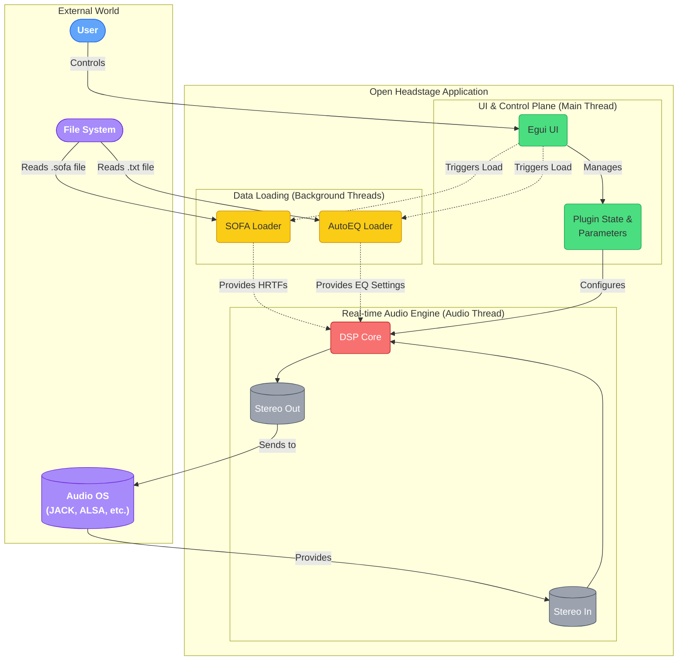
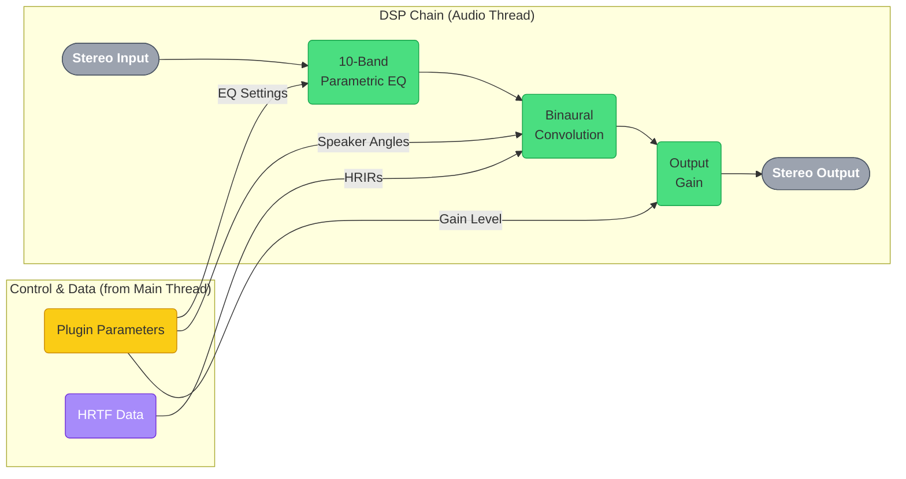

# Open Headstage Architecture

This document provides a detailed overview of the Open Headstage plugin architecture, intended to guide AI agents and human developers in maintaining and extending the project.

## 1. Overview

Open Headstage is an open-source, multiplatform binaural speaker simulation application. Its primary goal is to provide a high-quality, flexible tool for experiencing stereo audio over headphones as if listening to physical speakers in a well-defined acoustic space.

The project is developed as a **standalone application first**, targeting Linux, Windows, and macOS. This standalone version serves as the primary platform for development, debugging, and use. The core logic is also bundled as a **CLAP plugin** for use in digital audio workstations (DAWs), although this is considered an experimental, secondary goal.

The application processes stereo audio input, applies binaural spatialization using Head-Related Transfer Functions (HRTFs), and applies a 10-band parametric headphone equalizer.

## 2. Architecture Diagrams

### 2.1. High-Level Application Architecture

This diagram shows the main components of the Open Headstage application and how they interact with the user and the underlying system.

### 2.2. Real-time Audio Signal Flow

This diagram details the specific stages of the real-time digital signal processing (DSP) chain that your audio passes through.

## 3. Tech Stack

*   **Core Language:** Rust (2024 Edition)
*   **Plugin Framework:** `nih-plug` (Used for its audio processing abstractions and standalone application wrapper)
*   **Plugin Formats:**
    *   **Standalone:** The primary build target.
    *   **CLAP (Experimental):** Bundling is supported, but full DAW compatibility is under development.
    *   **VST3 (Disabled):** VST3 support has been explicitly disabled to avoid the GPLv3 license of the VST3 SDK.
*   **DSP Libraries:**
    *   `rustfft`: For Fast Fourier Transforms, used in the convolution engine.
    *   `biquad`: For the parametric equalizer implementation.
*   **SOFA HRTF Handling:**
    *   `libmysofa`: C library for loading SOFA files.
    *   `bindgen`: Used in `build.rs` to generate Rust FFI bindings to `libmysofa`.
*   **User Interface:**
    *   `egui` (via `nih_plug_egui`): For creating the graphical user interface.
    *   `egui-file-dialog`: For a self-contained, host-compatible file dialog rendered within `egui`.
*   **Serialization:**
    *   `serde`: For serializing and deserializing application state (e.g., parameters).
*   **Build System:** Cargo
*   **CI/CD:** GitHub Actions

## 4. Module Breakdown

The core logic is primarily located in the `src/` directory.

### 4.1. Headphone EQ Search & Update (`build.rs`, `src/lib.rs`, `src/autoeq_parser.rs`)

This feature provides dynamic, searchable access to the entire AutoEQ headphone database.

*   **Architecture:** The feature is built on a decoupled, multi-threaded architecture to ensure real-time safety.
    *   **UI Thread:** Managed by `egui`, captures user input (search queries, button clicks). It is forbidden from performing blocking operations.
    *   **Background Thread:** Managed by `nih-plug`'s `task_executor`. Used for non-real-time tasks like running `git pull` or parsing files from disk.
    *   **Real-Time Audio Thread:** The `process()` loop. It has strict no-allocation requirements.
*   **Data Management & Indexing:**
    *   **Data Source (`PRESERVE/AutoEq`):** A local clone of the `jaakkopasanen/AutoEq` git repository serves as the source of truth.
    *   **Build-Time Indexing (`build.rs`):** At compile time, a build script scans the `PRESERVE/AutoEq/results` directory, extracts headphone metadata, and compiles it into a `headphone_index.json` file in the `OUT_DIR`.
    *   **Bundled Index:** The generated `headphone_index.json` is bundled directly into the plugin binary using `include_str!`, ensuring full functionality on first launch.
    *   **In-Memory Index:** The loaded index is deserialized into a `Vec<Headphone>` and stored in an `Arc<RwLock<...>>` for thread-safe searching from the UI.
*   **UI & Search Logic (`src/lib.rs`):**
    *   An `egui::TextEdit` widget captures the user's search query.
    *   A custom `Debouncer` prevents search logic from running on every keystroke.
    *   Search results are displayed in a scrollable list of buttons. Results are prioritized to show "oratory1990" measurements first, and the source is displayed to differentiate between measurements.
*   **Asynchronous Operations:**
    *   **Profile Loading:** Clicking a search result creates a `Task::LoadAutoEq`, which is sent to the `task_executor`. The background task calls `autoeq_parser::parse_autoeq_file`, and the result is returned to the UI via a shared `Arc<Mutex<Option<AutoEqProfile>>>` which the UI polls.
    *   **Database Update:** Clicking "Update Database" dispatches a `Task::UpdateHeadphoneDatabase`. The background task runs `git pull` in the `PRESERVE/AutoEq` directory. It notifies the UI of completion via a shared `Arc<AtomicBool>`.

### 4.2. Main Plugin Logic (`src/lib.rs`)

*   **Responsibility:** Defines the main application structure (`OpenHeadstagePlugin`), its parameters (`OpenHeadstageParams`), and implements the `nih_plug::prelude::Plugin` trait. It orchestrates the interaction between different modules.
*   **Key Structs:**
    *   `OpenHeadstagePlugin`: Holds the application state, including instances of the DSP modules and parameters.
    *   `OpenHeadstageParams`: Defines all user-configurable parameters.
*   **Core Methods:**
    *   `initialize()`: Sets up the application and configures DSP modules based on the buffer configuration.
    *   `process()`: The main audio processing callback.
    *   `editor()`: Provides the GUI editor.

### 4.3. Digital Signal Processing (`src/dsp/`)

*   **`src/dsp/convolution.rs` (ConvolutionEngine)**
    *   **Responsibility:** Performs binaural convolution using HRTFs via an efficient FFT-based method.
*   **`src/dsp/parametric_eq.rs` (StereoParametricEQ, BiquadFilter)**
    *   **Responsibility:** Implements a 10-band stereo parametric equalizer for headphone correction.

### 4.4. SOFA HRTF Handling (`src/sofa/`)

*   **`src/sofa/loader.rs` (MySofa)**
    *   **Responsibility:** Provides a safe Rust wrapper around the `libmysofa` C library for loading and interacting with SOFA files.
    *   **Details:** Handles opening SOFA files, extracting HRIR data for specified speaker angles, and ensuring proper resource management.
    *   **FFI:** Relies on `bindgen` (configured in `build.rs`) to generate the raw C bindings.

### 4.5. AutoEQ Parser (`src/autoeq_parser.rs`)

*   **Responsibility:** Parses headphone correction data from AutoEQ project text files to configure the `StereoParametricEQ`.

### 4.6. Build Script (`build.rs`)

*   **Responsibility:** Generates FFI bindings to `libmysofa` using `bindgen` and indexes the AutoEQ headphone profiles before the rest of the Rust code is compiled.

### 4.7. GUI Structure (`src/lib.rs` `editor()` method)

The user interface is built using `egui` and follows an "immediate mode" paradigm, where the UI is declared from scratch on every frame. The layout is defined within the `editor()` method in `src/lib.rs`.

*   **Main Layout:** The UI is composed of a main `egui::CentralPanel` which contains all the primary controls.
*   **Collapsible Sections:** The main panel is organized into logical sections using `egui::collapsing_header::CollapsingHeader`. This keeps the UI tidy and allows the user to focus on one area at a time.
*   **Conditional Side Panel (PEQ Editor):** A `egui::SidePanel` is used for the detailed Parametric EQ editor. Its visibility is controlled by a boolean flag in the `EditorState` struct.
*   **File Dialogs:** File dialogs are handled by the `egui-file-dialog` crate. The dialog is an `egui` window that is drawn on top of the main UI.

### 4.8. Conditional Control with Presets

To provide user-friendly presets while still allowing for manual control, the plugin uses a combination of an `EnumParam` and `ui.add_enabled()`.

1.  **Preset `EnumParam`:** An enum (`StereoAnglePreset`) is defined to represent the available presets, including a `Manual` variant.
2.  **`ComboBox` for Selection:** An `egui::ComboBox` is used in the UI to allow the user to select a preset.
3.  **Conditional Logic:** When the `ComboBox` is changed, the plugin programmatically updates the associated `FloatParam` values for the azimuth angles.
4.  **`ui.add_enabled()` for Conditional UI:** The `ui.add_enabled()` function wraps the manual sliders, enabling them only when the `Manual` preset is selected.

## 5. Build Process

*   **Prerequisites:**
    *   Rust toolchain (version 1.87.0 or newer).
    *   `libmysofa` development libraries (e.g., `libmysofa-dev` on Debian/Ubuntu).
    *   For UI: A full GTK3 development environment (e.g., `libgtk-3-dev`).
*   **Compilation:**
    *   `cargo build --release`: Compiles the standalone application in release mode.
*   **Output:** The compiled standalone application is located in `target/release/`.
*   **Bundling (for CLAP):**
    *   `cargo xtask bundle open-headstage --release`: Builds and installs the CLAP plugin into the user's `.clap` directory.

## 6. Testing

*   **Primary Method:** The canonical way to test, debug, and benchmark is to compile and run the **standalone application**. This provides a minimal host that connects to a real audio backend like JACK, allowing for high-fidelity, out-of-process integration testing.
*   **Unit Tests:** Located alongside the code in `#[cfg(test)]` blocks. Run with `cargo test`.
*   **CI:** The GitHub Actions workflow in `.github/workflows/rust_ci.yml` runs `cargo fmt`, `cargo clippy`, `cargo build`, and `cargo test`.

## 7. Cross-cutting Concepts

*   **Threading & State Management:** To prevent GUI-related recursion warnings, the application follows a strict, unidirectional threading pattern for tasks initiated from the UI (e.g., loading a file): **GUI -> Audio Thread -> Background**. Results are communicated back to the GUI via polling a shared `Arc<Mutex<T>>`, which decouples the threads.
*   **Crate Structure (`lib.rs` vs. `main.rs`):** The project uses the standard Rust pattern where `src/lib.rs` defines the core library logic and `src/main.rs` defines a binary crate that consumes the library to create the standalone executable.

## 8. Contribution Guidelines for AI Agents

*   **Understand the Goal:** Refer to `TODO.md` and `BUGS.md` before making changes.
*   **Follow Existing Patterns:** Adhere to the module structure and coding style.
*   **Parameter Handling:** Use `nih_plug`'s `Param` types for host-automatable values. For other persistent state (like file paths), use `#[persist]` on a thread-safe container (e.g., `Arc<RwLock<String>>`).
*   **DSP Code:** Prioritize correctness and clarity. Be mindful of real-time constraints in the `process()` loop.
*   **Testing:** Write unit tests for new logic. Ensure `cargo test` passes.
*   **Documentation:** Add Rustdoc comments. Update this document for significant architectural changes.
*   **Error Handling:** Use `Result<T, E>` for functions that can fail.

## 9. License Management

*   **Software Bill of Materials (SBOM):** `LICENSES.md` tracks all third-party dependencies and their licenses.
*   **Primary Project License:** Apache License, Version 2.0.
*   **GPLv3 Consideration:** VST3 support is disabled. If re-enabled, its GPLv3 license would apply to any distributed VST3 binary.

## 10. Future Vision

This section outlines potential future directions for the project.

*   **Surround Sound to Stereo Mixdown:** Extend the engine to support 5.1 and 7.1 surround sound input, rendering a high-quality binaural mixdown.
*   **Dynamic Head Tracking:** Integrate dynamic head tracking to adjust the binaural rendering in real-time for a more immersive experience.

---
This document is a living guide. It should be updated as the project evolves.